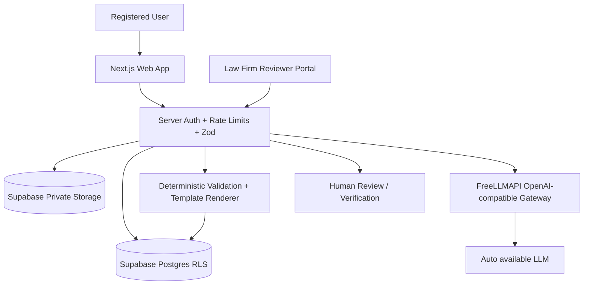

# Technical Architecture

## Minimal-cost architecture
- Next.js App Router, TypeScript, Tailwind, shadcn/ui; deploy to Vercel **only when deployment plan and commercial terms are appropriate**.
- Supabase Auth (email/password + Google OAuth if configured), PostgreSQL, private Storage, RLS.
- Next.js route handlers/server actions for backend (modular monolith).
- Owner's gateway `freellm.hellvyn.id` is OpenAI-compatible. Actual **base URL/path, API key, response behavior, and model identifiers need environment configuration/verification**.
- `model: "auto"` on **every** LLM call. Router selects based on available free provider capacity; no manual per-task model routing.
- No separate FastAPI, queue broker, or vector DB required initially. `pgvector`/legal RAG can be added once official legal corpus and ingestion are ready.



## Gateway integration
- Use official OpenAI JS SDK **only if compatible with verified endpoint**.
- Env: `FREELLM_BASE_URL`, `FREELLM_API_KEY`; enforce literal `model: "auto"` (no model env override).
- Server-only call. Example:

```ts
import OpenAI from "openai";
const client = new OpenAI({
  apiKey: process.env.FREELLM_API_KEY!,
  baseURL: process.env.FREELLM_BASE_URL!,
});
const result = await client.chat.completions.create({
  model: "auto",
  messages: [
    { role: "system", content: "You are Yuktanya AI. Never invent legal citations or facts." },
    { role: "user", content: "..." },
  ],
});
```

- Gateway `auto` may select different models on successive calls. **Do not rely on model-specific structured-output features.** Ask for JSON and validate with Zod; retry repair within bounded limits; fall back to manual form entry on failure.
- Apply strict timeouts, request-size caps, account rate limits, concurrency caps, and bounded retries/backoff; avoid retry storms and duplicate paid operations.
- Record safe operational metadata (`request_id`, timestamp, latency, success, optional returned model/provider if available) **without logging prompts, document text, credentials, or sensitive data**.
- Availability routing is not proof of quality. Benchmark Indonesian legal outputs against lawyer-approved fixtures and measure per-model only if gateway exposes attribution.
- If gateway can switch to providers with differing retention/data policies, assess and configure an allowlist before transmitting confidential client documents. If not possible, **block sensitive uploads to AI** until resolved.
- Confirm that upstream free API usage terms allow commercial use and this routing arrangement; self-hosting a gateway does not waive upstream restrictions.

## Document engine
1. Intent/category selection.
2. Template version lookup (`approved` only in production).
3. Structured interview to fill Zod-validated fields.
4. Clause selection constrained by approved template.
5. Deterministic checks: required fields, consistency, date logic, amounts, unsupported assertions, missing sources.
6. Server-side DOCX/PDF rendering; maintain canonical structured source.
7. Save canonical immutable version and SHA-256 of the exact bytes submitted for review; preserve that byte artifact, and separately identify PDF/DOCX exports whose hashes may differ. Verification must identify the reviewed artifact and hash unambiguously.
8. AI pre-review: **informational**, never verified legal opinion.
9. On human review, bind review to immutable submitted version.

## Long-running work
Vercel function execution limits may not fit long LLM responses. For first pilot, constrain workloads and use bounded requests. For longer tasks use Supabase-backed jobs with a **secure worker execution mechanism** (possibly existing server) rather than pretending a Vercel function can run indefinitely. Implement job leasing, idempotency, timeout, and retry if introduced.

## Suggested module layout
```
src/app/(public)/
src/app/(auth)/
src/app/(app)/dashboard/
src/app/(app)/workspace/
src/app/(app)/documents/
src/app/(app)/vault/
src/app/(partner)/partner/
src/app/api/ai/
src/app/api/documents/
src/app/api/reviews/
src/app/api/billing/
src/lib/auth/
src/lib/ai/
src/lib/documents/
src/lib/pricing/
src/lib/reviews/
src/lib/supabase/
src/lib/security/
src/components/
```

## Integrations deferred
Certified electronic signatures, e-meterai, automated subscription payments, notifications, legal regulation ingestion/RAG, advanced clause editor, detailed enterprise matter management.

## Analytics module
Add `/admin/*` server-protected routes and sanitized server-side event instrumentation. Store operational metrics in Supabase and compute aggregates using restricted SQL/views/functions or server-side queries. See `ADMIN_DASHBOARD.md`; do not use external paid analytics for MVP.

## AI quota by plan (latest)
Enforce authenticated plan-aware daily quota in trusted backend: Free 20 AI messages/1 new document, active Member 60 AI messages/5 new documents, Asia/Jakarta midnight reset. Quota counters transactional and idempotent. See `AI_FAIR_USAGE.md`.

## v8 — review services and trust boundaries
Three route groups `/dashboard`, `/partner`, `/admin`, independently server guarded. Shared
components do not imply shared data permissions. Modular monolith services: StandardReview,
LegalNotes, DeepEligibility, PricingQuotes, Settlement, ChecklistApproval, Verification,
Revocation, AuditOutbox and Analytics. Supabase transaction/RPC owns cross-row invariants.

Suggested API contracts (names may adapt; semantics must not):
- GET /api/reviews/:id/deep-eligibility -> eligible/reason codes, parent/version; owner only.
- POST /api/reviews/:id/deep-quote -> server quote/price/expiry; eligibility recheck.
- POST /api/deep-reviews -> quote_id + idempotency key; transaction reserves live parent.
- PATCH /api/partner/reports/:id/notes -> draft revision/If-Match; assigned qualified reviewer.
- PUT /api/partner/deep-reviews/:id/checklist -> draft revision, evidence assessments.
- POST /api/partner/reviews/:id/complete -> explicit scope/outcome; server-issued LEGAL.
- POST /api/partner/deep-reviews/:id/decision -> explicit attestation/decision; atomic guard.
- POST /api/admin/verifications/:id/revoke -> capability + reason, append event + projection.
- GET /verify/:code -> minimal public projection, rate-limited, current revocation status.
Stable errors: AUTH_REQUIRED, FORBIDDEN, STANDARD_NOT_COMPLETED, NO_ACTIONABLE_LEGAL_NOTES,
VERSION_MISMATCH, PARENT_REVOKED, DEEP_ALREADY_EXISTS, QUOTE_EXPIRED, PAYMENT_NOT_VERIFIED,
CHECKLIST_INCOMPLETE, MATERIAL_CRITERIA_NOT_MET, REVIEWER_NOT_AUTHORIZED, STALE_REVISION.
Use 401/403/409/422 consistently; unknown owned IDs must not leak other users' resources.
Payment callbacks have provider verification or controlled manual reconciliation, trusted
event IDs and idempotency. Transactional outbox retries QR/notification work after commit;
failure cannot produce fake completion or duplicate records. Public QR lookup reads current
authoritative status; historical PDF cannot promise current active status without lookup.
Feature flags AI_PRE_REVIEW, DEEP_REVIEW_PURCHASE, ENHANCED_ISSUANCE default OFF in
production pending corresponding gates. Flags never waive auth, quota or professional checks.
Retain secure worker lease/idempotency if workload exceeds hosting request limits.
